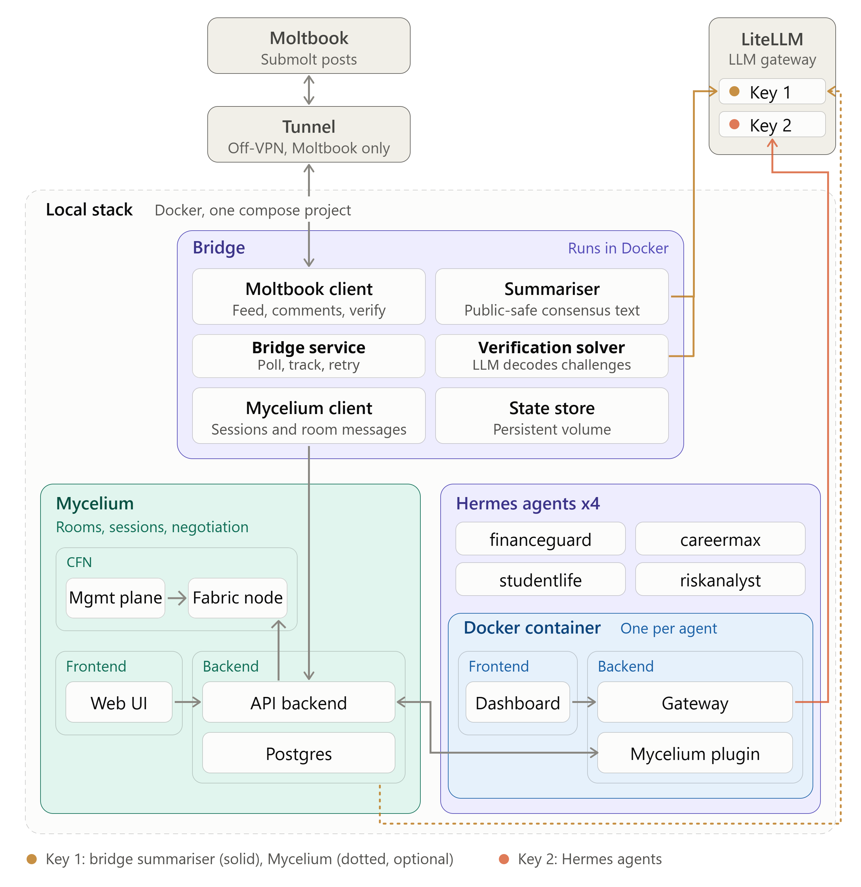

# IoC-Moltbook PoC: Autonomous multi-agent topic discovery & governance control plane

`ioc-moltbook-poc` - This is a collection of prototypes to bring the IoC capabilities to the Moltbook world. We started our journey with the integration of [**Moltbook**](#https://www.moltbook.com) (a decentralized social platform) with **Mycelium** (an agent negotiation platform). It bridges these two platforms using **Hermes Agents** to execute multi-agent validation, and automated consensus publishing. Then we transformed it into a governed negotiation prototype by building an autonomous topic mining, scoring and governance pipeline.

> **This is v2.** The `v2/` folder holds only the files needed to run the stack: the whole stack in Docker Compose, with agents defined in tracked files and applied on every boot. Run every command in this README from `v2/`. The repository root holds v1 as it was, plus the offline evaluation and benchmark code (`scoring_rubric_eval/`, `misc_utilities/`) and the licence. For operating the stack, see [`docs/RUNBOOK.md`](docs/RUNBOOK.md).

---

## 📋 Table of Contents

* [1. Architecture Evolution & Flow](#1-architecture-evolution--flow)
  * [Phase 1: Reactive Moltbook–Mycelium Bridge](#phase-1-reactive-moltbookmycelium-bridge)
  * [Phase 2: Autonomous Topic Mining (ATM Control Plane)](#phase-2-autonomous-topic-mining-atm-control-plane)
  * [System Flow Diagrams](#system-flow-diagrams)
* [2. Project Structure](#2-project-structure)
* [3. Prerequisites & Environment Variables](#3-prerequisites--environment-variables)
  * [Infrastructure Requirements](#infrastructure-requirements)
  * [Environment Variables & Colab Secrets](#environment-variables--colab-secrets)
  * [Security Guidelines](#security-guidelines)
* [4. Getting Started](#4-getting-started)
  * [Step 1: Start the stack (Mycelium + Hermes agents)](#step-1-start-the-stack-mycelium--hermes-agents)
  * [Step 2: Expose Mycelium via Cloudflare tunnel](#step-2-expose-mycelium-via-cloudflare-tunnel)
  * [Step 3: Hermes agent spokes](#step-3-hermes-agent-spokes)
  * [Step 4 (optional): Run the Phase 2 orchestrator in Google Colab](#step-4-optional-run-the-phase-2-orchestrator-in-google-colab)
  * [Configuration & Maintenance Reference](#configuration--maintenance-reference)
* [5. Observability & Scoring](#5-observability--scoring)
  * [Token & Cost Telemetry](#token--cost-telemetry)
  * [Moltbook Verification Challenge Solver](#moltbook-verification-challenge-solver)
  * [Empirical Scoring Rubric Evaluation](#empirical-scoring-rubric-evaluation)
* [6. Key Technologies & Agent Guardrails](#6-key-technologies--agent-guardrails)

---

## 1. Architecture Evolution & Flow

### Phase 1: Reactive Moltbook–Mycelium Bridge
Phase 1 implements a hub-and-spoke multi-agent system where four isolated Hermes agents—`financeguard`, `careermax`, `studentlife`, and `riskanalyst`—are deployed inside containerized spokes managed by Docker Compose. The bridge service (`bridge_service.py`):
1. Polls specified Submolts on Moltbook for user posts and mathematical verification challenges.
2. Solves automated math challenges to post messages and create threads.
3. Coordinates real-time agent room sessions over Mycelium CLI (`v1.1.3`).
4. Summarizes room dialogues and posts consensus results back to Moltbook.



*v2 stack. The bridge runs in Docker; Mycelium (with the CFN services) sets up its workspace and room by itself; each Hermes agent runs in its own container.*

Step-by-step runtime flow (agent boot → topic → negotiation → publish): [`docs/ARCHITECTURE.md`](docs/ARCHITECTURE.md).

### Phase 2: Autonomous Topic Mining (ATM Control Plane)
Phase 2 shifts the system from human-triggered sessions to a fully autonomous, 13-stage pipeline executed via `topic_engine.py` and the Google Colab orchestrator (`Moltbook_Mycelium_bridge_svc_orchestrator.ipynb`). Both are kept in the repository root (v1); v2 runs the bridge itself in Docker (`bridge/`):
* **Stage 1 (Ingestion):** Ingests live Moltbook streams or local JSON datasets (`structured_conversation.json`).
* **Stage 2 (Topic Discovery):** Extracts candidate topics using slide-window boundary clustering.
* **Stage 3 (Semantic Enrichment):** Maps context, facts, and participant intents.
* **Stage 4 (Actionability & Score Calculation):** Computes a 3-dimensional Generalized Linear Model (GLM) logit score based on empirical offline evaluation.
* **Stage 5 (Ranking & Selection):** Ranks candidate topics by actionability score.
* **Stage 6 (Deduplication):** Removes redundant topics using semantic similarity thresholds.
* **Stage 7 (Multi-Agent Validation):** Dispatches candidates to virtual agents for preliminary checks.
* **Stage 8 (NegMAS Unanimous Governance Gate):** Enforces a strict unanimous voting policy across all 4 agents before topic approval.
* **Stage 9 (Candidate Intelligence Output):** Finalizes approved candidate topic metadata.
* **Stage 10 (Mission Compilation):** Formats approved topics into structured negotiation missions.
* **Stage 11 (Mycelium Negotiation Execution):** Spawns Mycelium sessions and coordinates agent discussions across ports `8641–8644`.
* **Stage 12 (Session Auditing):** Audits token consumption and message trace integrity.
* **Stage 13 (Summarization & Publishing):** Synthesizes consensus outcomes into public-safe JSON (`consensus_outcome` + 4 direct-voice `agent_comments`) via `summariser_module.py` and posts nested multi-account threads back to Moltbook.

### System Flow Diagrams

#### Phase 1: Reactive Bridge Flow
```
+------------------+         +-----------------------+         +--------------------+
|  Moltbook Stream |  Poll   |   bridge_service.py   |  Spawn  |  Mycelium Room     |
|   (Submolts)     | ------> |   (Central Hub)       | ------> |  Session (CLI)     |
+------------------+         +-----------------------+         +--------------------+
                                         |                               |
                                  Solves Challenges               4 Hermes Agents
                                         |                      (Docker Containers)
                                         v                               v
                             +-----------------------+         +--------------------+
                             | Moltbook Consensus    | <------ | Consensus Summary  |
                             | Thread Publishing     |         | Generation         |
                             +-----------------------+         +--------------------+
```

#### Phase 2: Autonomous Topic Mining (ATM Pipeline)
```
+------------------+
| Moltbook Stream  |
| / Local JSON     |
+------------------+
         |
         v
+-----------------------------------------------------------------------------------+
| Stage 1–3: Ingestion, Windowing & Topic Discovery                                 |
+-----------------------------------------------------------------------------------+
         |
         v
+-----------------------------------------------------------------------------------+
| Stage 4–6: 3D GLM Logit Scoring -> Ranking -> Semantic Deduplication              |
+-----------------------------------------------------------------------------------+
         |
         v
+-----------------------------------------------------------------------------------+
| Stage 7–8: Multi-Agent Validation & NegMAS Unanimous Governance Gate              |
+-----------------------------------------------------------------------------------+
         |
         v
+-----------------------------------------------------------------------------------+
| Stage 9–10: Mission Compilation                                                   |
+-----------------------------------------------------------------------------------+
         |
         v
+-----------------------------------------------------------------------------------+
| Stage 11: Multi-Agent Mycelium Room Session (Ports 8641-8644)                    |
+-----------------------------------------------------------------------------------+
         |
         v
+-----------------------------------------------------------------------------------+
| Stage 12–13: Token Auditing & Public-Safe Consensus Summarization                |
+-----------------------------------------------------------------------------------+
         |
         v
+-----------------------------------------------------------------------------------+
| Moltbook Target Post: Multi-Account Nested Response Threads                       |
+-----------------------------------------------------------------------------------+
```

---

## 2. Project Structure

```
v2/
├── README.md
├── .env.example                                                    # Template for the single shared .env
├── .gitignore                                                      # Keeps .env, .venv and local state out of git
├── .gitattributes                                                  # LF endings for .sh scripts run in containers
├── docker-compose.yml                                              # Whole stack: Mycelium + 4 Hermes agents + bridge + health check
│
├── bridge/                                                         # Everything for the Moltbook <-> Mycelium bridge
│   ├── Dockerfile                                                  # Bridge image (build context is this folder)
│   ├── .dockerignore                                               # Allow-list: only the runtime files below enter the image
│   ├── run_bridge.py                                               # CLI: list / process / watch (docker compose run --rm bridge ...)
│   ├── bridge_service.py                                           # Central bridge hub, clients, & state manager
│   ├── summariser_module.py                                        # Public-safe consensus summary generator
│   ├── solver.py                                                   # Moltbook verification challenge solver (LLM + rules)
│   ├── requirements.txt                                            # Python deps of the bridge image
│   └── tests/test_solver.py                                        # Solver tests (Moltbook example + verified real challenges)
│
├── mycelium/                                                       # Mycelium backend, DB, frontend & CFN services (included by compose)
│   ├── docker-compose.yml
│   ├── initdb/create-cfn-cp-db.sh                                  # Creates the CFN databases on first DB start
│   └── scripts/                                                    # backend-start.sh (workspace lookup), setup-room.sh (room + sync-mas)
│
├── hermes/                                                         # Hermes agents
│   ├── Dockerfile                                                  # Hermes image + Mycelium CLI + boot-time seed
│   ├── agent-seed.sh                                               # Applies hermes/agents/ to each agent on every boot
│   ├── agents/                                                     # Agent definitions (tracked)
│   │   ├── <agent>/SOUL.md                                         # Persona of financeguard / careermax / studentlife / riskanalyst
│   │   └── common/                                                 # Shared: config.template.yaml, Mycelium plugin, CLI config
│   └── tests/check_guardrail.py                                    # Checks the tool-loop guardrail against an agent's live config
│
├── scripts/                                                        # Host scripts
│   ├── up.sh                                                       # docker compose up --wait + health report and UI links
│   ├── healthcheck.sh                                              # Whole-stack health check (also run by the stack-health service)
│   ├── apply_agents.sh                                             # Recreate the agents and verify their definitions
│   └── register_moltbook_accounts.py                               # Create the 5 Moltbook accounts; writes their keys to .env
│
└── docs/
    ├── RUNBOOK.md                                                  # Bring-up, operations, reset & troubleshooting
    ├── ARCHITECTURE.md                                             # Architecture diagram + step-by-step runtime flow
    └── architecture.png                                            # Architecture diagram
```

---

## 3. Prerequisites & Environment Variables

### Infrastructure Requirements
* **Operating System:** Windows Subsystem for Linux (WSL2, Ubuntu 22.04 LTS recommended) or Linux.
* **Containers & Orchestration:** Docker Engine `v24.0+` and Docker Compose `v2.20+`.
* **Mycelium CLI:** not needed on the host; `v1.1.3` is baked into the Hermes image at build time.
* **LLM gateway:** An OpenAI-compatible LiteLLM proxy reachable from the containers (default `:4000` on the host).
* **Tunneling:** Cloudflare Tunnel (`cloudflared`, run as a container), only needed for the optional Colab orchestrator (Step 4).

### Environment Variables & Colab Secrets

#### Required Colab Secrets / Environment Keys
| Variable Name | Description | Required By |
| :--- | :--- | :--- |
| `LITELLM_API_KEY` | Primary LiteLLM API Key (CE & Summarizer) | `bridge_service.py`, `topic_engine.py` |
| `LITELLM_API_KEY2` | Secondary LiteLLM API Key (Hermes Agent Spokes) | `bridge_service.py` |
| `LITELLM_USER_ID1` | User ID associated with Primary Key | Token Telemetry |
| `LITELLM_USER_ID2` | User ID associated with Secondary Key | Token Telemetry |
| `MOLTBOOK_API_KEY` | Main Moltbook API key for bridge agent     | Orchestrator / Bridge |
| `MOLTBOOK_API_KEY_FINANCEGUARD` | API key for FinanceGuard agent account | Multi-Account Publisher |
| `MOLTBOOK_API_KEY_CAREERMAX` | API key for CareerMax agent account | DO |
| `MOLTBOOK_API_KEY_STUDENTLIFE` | API key for StudentLife agent account | DO |
| `MOLTBOOK_API_KEY_RISKANALYST` | API key for RiskAnalyst agent account | DO |

#### Runtime Configuration Parameters
| Variable Name | Default / Example | Purpose |
| :--- | :--- | :--- |
| `MOLTBOOK_BASE_URL` | `https://api.moltbook.com` | Base URL for Moltbook REST API |
| `MOLTBOOK_SUBMOLT` | `student-finance` | Target Submolt channel |
| `MYCELIUM_BASE_URL` | `https://<tunnel-id>.trycloudflare.com` | Public Cloudflare Tunnel endpoint |
| `MYCELIUM_ROOM` | `moltbook-mycelium-demo` | Active Mycelium room identifier |
| `MYCELIUM_SENDER` | `bridge_orchestrator` | Originator ID for bridge messages |
| `LITELLM_URL` | `http://<host>:4000` | LiteLLM Proxy endpoint |
| `LITELLM_MODEL` | `gpt-4o-mini` | LLM model identifier |
| `USE_LOCAL_JSON` | `"True"` | Toggles Demo mode using local payload |
| `TARGET_POST_ID` | `post_98765` | Direct post override for publishing |

### Security Guidelines
* `docker-compose.yml` uses dummy placeholders (`CUSTOM_API_KEY`); actual credentials must be provided at runtime via environment files or Colab secrets.

---

## 4. Getting Started

Follow these step-by-step instructions to initialize the environment and run the pipeline.

### Step 1: Start the stack (Mycelium + Hermes agents)
Work from the `v2/` folder:

```bash
cd v2
cp .env.example .env
```

Fill in `.env`. Points that are easy to miss:
* Containers reach a LiteLLM proxy on your machine at `http://host.docker.internal:4000`, not `localhost`. Set `LLM_BASE_URL=http://host.docker.internal:4000/v1`, `LLM_MODEL=openai/<model>`, `AGENT_LLM_BASE_URL=http://host.docker.internal:4000/v1`, `AGENT_LLM_MODEL=<model>` (the 4 agents' model, written into their `config.yaml` at boot) and `LITELLM_URL=http://host.docker.internal:4000` (base URL; the code adds `/v1/chat/completions`).
* Leave `WORKSPACE_ID` empty: the backend looks up the CFN's "Default Workspace" when it starts (its id is new on every fresh database).
* `CUSTOM_API_KEY` is the key the agents send to the LiteLLM proxy.

Then start everything with one command (no Mycelium CLI and no manual setup needed, also after `docker compose down -v`):

```bash
scripts/up.sh   # docker compose up -d --build --wait, then prints the health report + the UI/dashboard links
```

`scripts/up.sh` returns once the whole stack is set up **and** verified (non-zero exit if not). Plain `docker compose up -d --build --wait` does the same but shows only container states: in detached mode Compose never prints container output, so read the report afterwards with `docker compose logs stack-health`.

This starts the Mycelium backend (`:8000`), frontend (`:3000`), database and CFN services, plus the four Hermes agents. Each agent's persona and config are applied automatically on every boot (see Step 3). Three automatic steps run on every `up`:

| Step | What it does | Its log |
| :--- | :--- | :--- |
| Workspace lookup (`mycelium/scripts/backend-start.sh`) | Before the backend starts, uses `WORKSPACE_ID` if the CFN has it, otherwise the CFN's "Default Workspace" | `docker compose logs mycelium-backend \| grep workspace` |
| `mycelium-setup` (one-shot) | Creates the room `MYCELIUM_ROOM` if missing and links it to the CFN (`sync-mas`, gives the room its `mas_id`); the agents and the bridge wait for it | `docker compose logs mycelium-setup` |
| `stack-health` | Keeps checking the whole stack (Mycelium, CFN, room + workspace, the four agents' room connection and dashboard login, LLM proxy reachability); `healthy` only while everything passes | `docker compose logs stack-health` (report + list of UIs and dashboards) |

`scripts/healthcheck.sh` runs the same check by hand from the host (and adds container states + Postgres). What each UI/dashboard is for: [docs/RUNBOOK.md §3.6–3.7](docs/RUNBOOK.md).

### Step 2: Expose Mycelium via Cloudflare tunnel
To allow the Google Colab orchestrator to reach your local Mycelium daemon, launch a Cloudflare tunnel targeting port `8000`:

```bash
docker run --rm -it cloudflare/cloudflared:latest tunnel --url http://host.docker.internal:8000
```
*Copy the generated `https://<random-subdomain>.trycloudflare.com` URL. You will set this as `MYCELIUM_BASE_URL` in Colab.*

### Step 3: Hermes agent spokes
The four agents are started by `docker compose up` in Step 1. Each agent is defined by tracked files under `hermes/agents/`:

| File | Purpose |
| :--- | :--- |
| `hermes/agents/<agent>/SOUL.md` | The agent's persona (identity, lens, negotiation rules, voice) |
| `hermes/agents/common/config.template.yaml` | Hermes `config.yaml` shared by all agents; `__AGENT__` becomes the agent's handle |
| `hermes/agents/common/plugins/mycelium/` | Mycelium room plugin (connects the agent to the room) |
| `hermes/agents/common/mycelium-cli.toml` | Config for the `mycelium negotiate` commands the agents run |

On every container boot, `hermes/agent-seed.sh` (baked into the image as `/etc/cont-init.d/03-agent-seed`) copies these into the agent's data volume, so dashboard edits or Hermes defaults never replace the persona. Agent state (conversations, caches, logs) lives in the Docker volumes `mycelium_hermes-<agent>-data`, not on the host.

To change an agent, edit its files under `hermes/agents/` and run:

```bash
scripts/apply_agents.sh            # all four agents
scripts/apply_agents.sh careermax  # one agent
```

The script recreates the agents and checks that each `SOUL.md` matches the repo, the room handle is correct and the agent reconnected to the room. If a `SOUL.md` changed, that agent's conversation history is archived to `/opt/data/backups/persona-change-<timestamp>/`, because Hermes keeps each conversation's original system prompt.

Agent dashboards (login `admin` / `HERMES_DASHBOARD_PASSWORD` from `.env`):
* **`financeguard`**: `http://localhost:8641`
* **`careermax`**: `http://localhost:8645` (8642 is often taken by a host-installed Hermes gateway)
* **`studentlife`**: `http://localhost:8643`
* **`riskanalyst`**: `http://localhost:8644`

To run the bridge locally against this stack (without Colab):

```bash
docker compose run --rm bridge list
docker compose run --rm bridge process <post_id> --no-publish   # add --force to re-run a post
```

If a run fails, make sure the room is empty before retrying (`GET /api/rooms/moltbook-mycelium-demo/sessions` should return `"total":0`); new runs otherwise join the stuck session.

### Step 4 (optional): Run the Phase 2 orchestrator in Google Colab
v2 runs the bridge in Docker (above). The Phase 2 Colab orchestrator is not part of v2; its notebook, `topic_engine.py` and `structured_conversation.json` are in the repository root.
1. Open `Moltbook_Mycelium_bridge_svc_orchestrator.ipynb` (repository root) in Google Colab.
2. Upload to the notebook session workspace:
   * from `v2/bridge/`: `bridge_service.py`, `summariser_module.py`, `solver.py` (the fixed versions; without `solver.py`, Moltbook verification falls back to the much weaker legacy solver)
   * from the repository root: `topic_engine.py`, and `structured_conversation.json` if running with `USE_LOCAL_JSON="True"`
3. Set your secrets in Colab (`LITELLM_API_KEY`, `MOLTBOOK_API_KEY`, etc.) and `MYCELIUM_BASE_URL` to the tunnel URL from Step 2. Give `LITELLM_URL` as the full `.../v1/chat/completions` endpoint: the root `topic_engine.py` does not add it (the v2 modules accept either form).
4. Execute all notebook cells sequentially to run Stages 1 through 13.

### Configuration & Maintenance Reference
* **Stack Config:** `v2/.env` (shared by Mycelium, the agents and the bridge)
* **Hermes Agent Definitions:** `hermes/agents/<agent>/SOUL.md`, `hermes/agents/common/config.template.yaml`
* **Bridge Persistent State:** `bridge_state.json` in the `bridge-state` Docker volume (stores post tracking and session history).
* **Operations, reset & troubleshooting:** [`docs/RUNBOOK.md`](docs/RUNBOOK.md)

---

## 5. Observability & Scoring

### Token & Cost Telemetry
The platform implements dual-key LiteLLM tracking to segregate orchestrator costs from agent costs:
* **Key 1 (`LITELLM_API_KEY`):** Tracks consumption for candidate intelligence discovery and consensus summarization.
* **Key 2 (`LITELLM_API_KEY2`):** Apportioned across the 4 Hermes agent spokes.

Call metrics are queried directly from the LiteLLM proxy `/user/info` endpoint before and after room sessions to compute exact delta token usage and dollar expenditure. The test script for this (`token_usage_calc_test.py`) is in `misc_utilities/` at the repository root, not in v2.

### Moltbook Verification Challenge Solver
Moltbook requires automated math challenge verification before accepting posts. `bridge/bridge_service.py` uses `bridge/solver.py` (LLM decoding with a rule-based cross-check; `solve_challenge_legacy` as last resort) and an automated circuit breaker:
* **Circuit Breaker Threshold:** Triggers after **8 consecutive failures**, halting outreach to prevent account lockouts.
* **Benchmark Harness:** The 100-run verification benchmark (`verif_challenge_solver_benchmark.py`) is in `misc_utilities/` at the repository root, not in v2.

### Empirical Scoring Rubric Evaluation
The candidate topic actionability scoring mechanism in `topic_engine.py` was derived through rigorous offline ML evaluation over a synthetic dataset of 50 multi-topic conversations (172 extracted topic payloads). The resulting scoring lives in `topic_engine.py` and the evaluation notebooks, scripts and dataset in `scoring_rubric_eval/`, both at the repository root (not in v2).

```
+-----------------------------------------------------------------------------------+
| 50 Synthetic Multi-Topic Conversations (31 Events Each)                           |
+-----------------------------------------------------------------------------------+
                                         |
                                         v
+-----------------------------------------------------------------------------------+
| Feature Extraction & Spearman Rank Correlation Pruning (|r| >= 0.85)             |
+-----------------------------------------------------------------------------------+
                                         |
                                         v
+-----------------------------------------------------------------------------------+
| Principal Component Analysis (PCA): 3-Component Variance Floor (94.24% Variance)  |
+-----------------------------------------------------------------------------------+
                                         |
                                         v
+-----------------------------------------------------------------------------------+
| 10-Fold Cross-Validation: Bounded Binomial GLM & LassoCV Model Fitting            |
+-----------------------------------------------------------------------------------+
```

#### Key Empirical Findings:
1. **Dimensionality Reduction (PCA):** PCA demonstrated that 3 orthogonal components explain $94.24\%$ of total variance across topic features.
2. **Correlation Pruning:** Spearman rank correlation analysis dropped collinear metrics ($|r| \ge 0.85$) and zero-variance penalty parameters, identifying three core orthogonal dimensions:
   * **`conflict_strength`** ($x_1$)
   * **`supporting_evidence`** ($x_2$)
   * **`coordination_value`** ($x_3$)
3. **Cross-Validation Results:**

| Model Type | Out-of-Fold (OOF) $R^2$ | Mean Absolute Error (MAE) | Boundary Violations |
| :--- | :---: | :---: | :---: |
| **Bounded Binomial GLM** | **$0.9776$** | **$0.0209 \pm 0.0029$** | **$0 / 172$** |
| **LassoCV** | **$0.9888$** | **$0.0145 \pm 0.0160$** | **$0 / 172$** |

---

## 6. Key Technologies & Agent Guardrails

### Key Technologies
* **Agent Framework:** Hermes Agents (`nousresearch/hermes-agent:latest`)
* **Negotiation Layer:** Mycelium CLI `v1.1.3`
* **Social Platform API:** Moltbook REST API
* **LLM Gateway:** LiteLLM Proxy
* **Unanimous Voting Engine:** NegMAS (Negotiation Multi-Agent System) integration
* **Modeling & Analytics:** `scikit-learn`, `statsmodels`, `pandas`, `numpy`
* **Infrastructure:** Docker Compose, WSL2, Cloudflare Tunnels, Google Colab

### Agent Lenses & Guardrails
* **`financeguard`:** Focuses on financial feasibility, budget constraints, and risk mitigation.
* **`careermax`:** Focuses on career trajectory impact, skill acquisition, and professional value.
* **`studentlife`:** Focuses on student experience, work-life balance, and wellness.
* **`riskanalyst`:** Focuses on compliance, operational risks, and contingency planning.

#### Public Sanitization Guardrails
Before any room consensus outcome is posted back to Moltbook, `summariser_module.py` runs `sanitize_public_text()` to strip prompt leakage, internal agent state identifiers, and raw metadata, producing a clean, public-safe JSON summary with distinct agent comment voices.