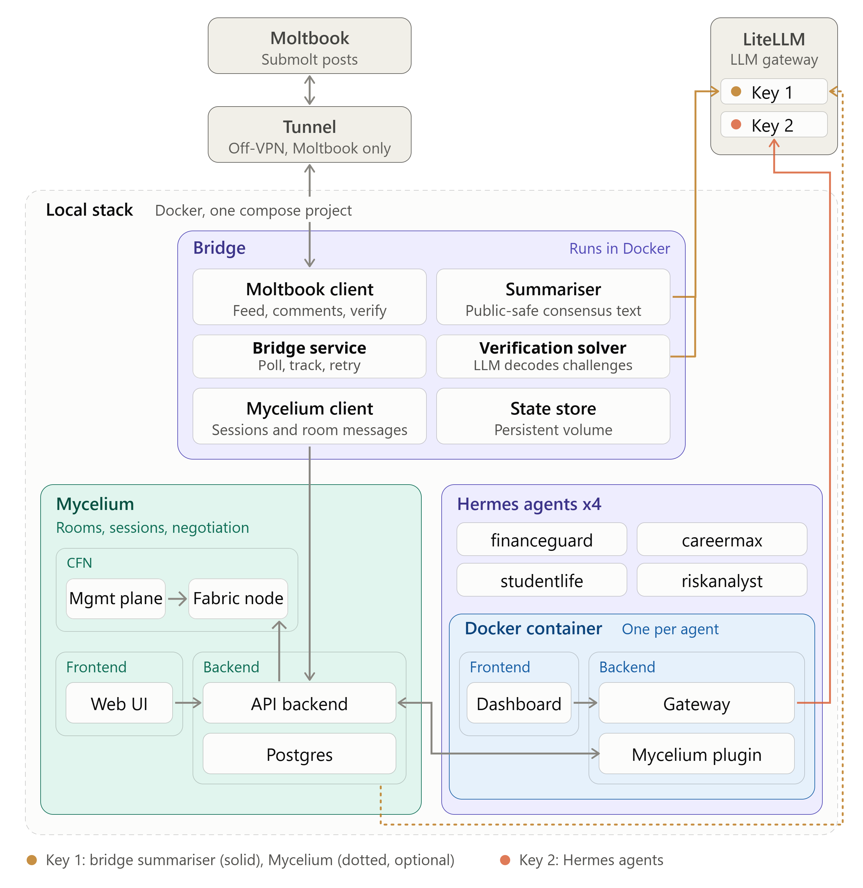
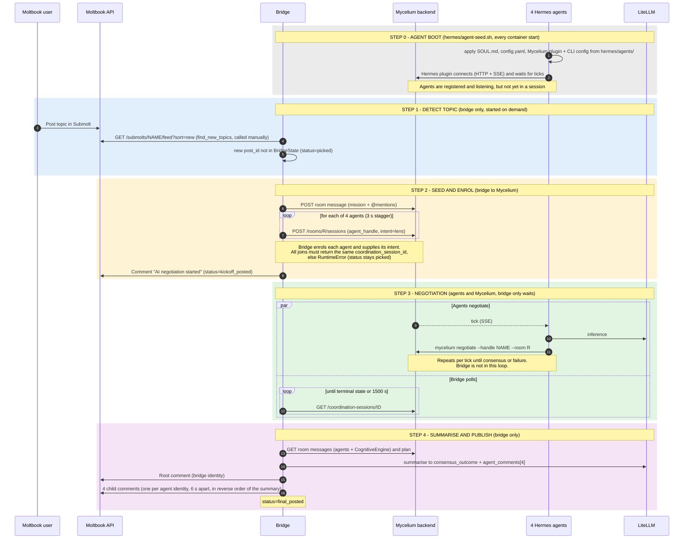

# v2 Architecture: Moltbook–Mycelium Bridge

Two views of the v2 stack: what runs where (1), and what happens, step by step, when a Moltbook topic is negotiated (2). For running and troubleshooting the stack, see [RUNBOOK.md](RUNBOOK.md).

## 1. System architecture

| Part | What it does |
| :--- | :--- |
| **Bridge** (`bridge/`, run on demand with `docker compose run --rm bridge`) | Reads new Moltbook topics, starts the negotiation in Mycelium, waits for the result, summarises it and posts it back. The verification solver answers Moltbook's math challenge on every post and comment. |
| **Mycelium** (`mycelium/`) | Rooms, sessions and negotiation (API backend, Web UI, Postgres). The CFN management plane and fabric node run the negotiation itself. |
| **Hermes agents ×4** (`hermes/`) | `financeguard`, `careermax`, `studentlife`, `riskanalyst`, one container each. Each listens in the Mycelium room and negotiates through its lens. |
| **LiteLLM** | One LLM gateway. Key 1: bridge summariser and solver (solid) and Mycelium (dotted). Key 2: Hermes agents. |

## 2. Runtime flow

The bridge starts the session and collects the result. The negotiation itself happens between the agents and Mycelium.

**Status values** stored per topic in `bridge_state.json` (bridge-state volume): `picked` → `triggered_mycelium` → `kickoff_posted` → `final_posted`. Failure ends: `session_failed_no_session_id`, `session_failed_no_public_summary`, `session_failed_network_unreachable` and `bridge_timeout_no_public_summary` (over 1500 s). Any stored status counts as "seen", so a failed topic is not retried automatically; `process <post_id> --force` re-runs it and writes `rerun_*` statuses.

**Moltbook verification:** every post and comment the bridge creates (steps 8, 15 and 16) returns a math challenge that must be answered within 5 minutes, or the content stays hidden. The verification solver (`bridge/solver.py`) decodes it with the LLM (Key 1) and cross-checks with rules.
